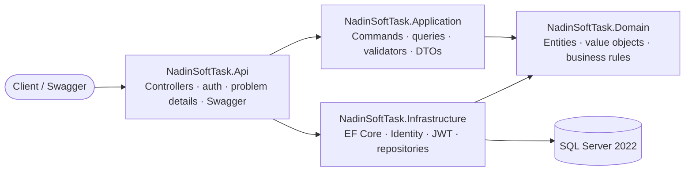
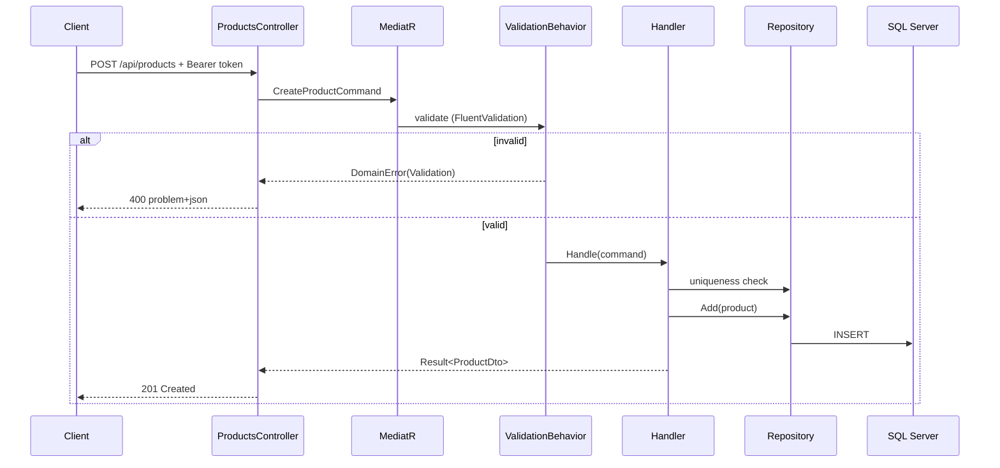

# NadinSoftTask

[](https://dotnet.microsoft.com/download/dotnet/8.0)
[](https://learn.microsoft.com/aspnet/core)
[](https://learn.microsoft.com/ef/core)
[](https://www.microsoft.com/sql-server)
[](https://docs.docker.com/compose/)
[](#how-to-test)
[](#api-reference)

Product catalogue REST API built with **ASP.NET Core 8**, **EF Core 8** and **SQL Server 2022**, following **Clean Architecture** and **CQRS**. Users register and log in with JWT, any authenticated user can create a product, and only the product's creator can update or delete it. Everyone can browse the catalogue.

> **Task:** Nadin Soft backend assignment — product CRUD.
> **Author:** [Hamidreza Izadi](https://github.com/armanizadi99)

---

## Quick start (60 seconds)

```bash
git clone https://github.com/armanizadi99/NadinSoftTask.git
cd NadinSoftTask
docker compose up --build -d
```

Then open **<http://localhost:8080/swagger>** (the API root redirects there). SQL Server starts first, the API waits for it to be healthy, and **EF Core migrations are applied automatically on startup** — no manual database setup.

Register a user from Swagger, click **Authorize**, paste the returned `accessToken`, and try the product endpoints.

Stop the stack with `docker compose down` (add `-v` to also delete the database volume).

---

## Overview

The API exposes a product catalogue whose authentication is built on **ASP.NET Core Identity** and **JWT**. User accounts and passwords are managed by ASP.NET Core Identity (`Identity Core` with EF Core stores), while HTTP requests are authenticated with JWT bearer access tokens issued by the application. A product belongs to the user who created it (`OwnerId` is taken from the access token, never from the request body). Listing is public; mutation is owner-only.

Beyond CRUD, the project is a complete example of the patterns the task asked for: CQRS handlers with MediatR, a FluentValidation pipeline behavior, AutoMapper profiles, a `Result`/`DomainError` model mapped to RFC 7807 problem details, and unit tests for every layer.

The API also includes registration, login and refresh-token endpoints, because "every authenticated user can create products" requires a way to become authenticated.

---

## Requirements coverage

| Requirement | Where it is implemented |
|---|---|
| Product CRUD | `ProductsController` + CQRS commands/queries |
| Only the creator can update/delete a product | `Product.EnsureOwnedBy`, owner check in `EditProductCommandHandler` / `DeleteProductCommandHandler` (403 otherwise) |
| Any authenticated user can create products | `[Authorize]` on `POST /api/products`; owner is `ICurrentUser.UserId` |
| Everyone can list all products or one user's products | Anonymous `GET /api/products`, `GET /api/products/by-user/{userId}` |
| Composite unique on produce date + manufacture email | `UX_Products_ProduceDate_ManufactureEmail` unique index; **global, not scoped to the owner** (see [Design notes](#design-notes)) |
| Efficient, low-footprint database types | `int` identity keys, `varchar` + UTF-8 collations, `date`, `bit`, `binary(32)`, `smalldatetime` (see [Data model](#data-model)) |
| Swagger / OpenAPI documentation | Swashbuckle at `/swagger`, XML comments, example schemas, bearer auth via **Authorize** |
| CQRS | MediatR commands and queries under `Application/Commands` and `Application/Queries` |
| Clean Architecture | `Domain` ← `Application` ← `Infrastructure` / `Api`; dependencies point inward |
| AutoMapper | `ProductProfile`, `IMapper` injected into handlers |
| Unit tests | 256 xUnit tests across domain, application, API filters and infrastructure |
| Docker support with Compose | `docker-compose.yml`: API + SQL Server 2022, healthcheck, named volume |
| .NET 8, ASP.NET Core, EF Core | `Directory.Build.props`, `net8.0`, EF Core 8.0.33 |
| **Migrations applied automatically on startup** | `Program.cs` runs `dbContext.Database.MigrateAsync()` when `Database:AutoMigrate` is `true` |
| Authentication: ASP.NET Core Identity + JWT | Identity Core (`Guid` keys) handles users, username uniqueness and password hashing through `UserManager`; JWT bearer access tokens (15 min) + rotating refresh tokens (7 days, stored only as a SHA-256 hash) protect the API |

---

## Tech stack

| Area | Technology |
|---|---|
| Runtime | .NET 8 (`net8.0`), ASP.NET Core 8 |
| Data access | EF Core 8.0.33, SQL Server 2022 |
| Identity & auth | ASP.NET Core Identity (`Identity Core` + EF Core stores, `Guid` keys) + JWT Bearer |
| CQRS / messaging | MediatR 12.5 |
| Validation | FluentValidation 12 + `ValidationBehavior` pipeline |
| Mapping | AutoMapper 15 |
| API docs | Swashbuckle.AspNetCore 7.2 |
| Tests | xUnit 2.9, Shouldly, Moq |
| Containerization | Docker, Docker Compose |

---

## Architecture



- **Domain** has no framework dependencies. It owns `Product`, the `Email`/`Phone` value objects, validation rules, `Result`/`DomainError`, and the ownership rule.
- **Application** depends only on Domain. It contains one folder per use case, FluentValidation validators, the MediatR `ValidationBehavior`, abstractions (`IProductRepository`, `IUnitOfWork`, `ICurrentUser`, `ITokenService`) and AutoMapper profiles.
- **Infrastructure** implements the abstractions with EF Core and Identity, and issues JWTs.
- **Api** is the composition root: controllers, JWT authentication, global exception handling, and the result filter that converts `Result` into HTTP responses.

### Request flow



Controllers return `Result`/`Result<T>` wrapped in `Ok(...)`, `StatusCode(201, ...)` or `StatusCode(204, ...)`. `ResultMappingFilter` unwraps the value on success and replaces failures with `application/problem+json`. This keeps error mapping out of every action and out of the domain.

---

## Project structure

```
NadinSoftTask/
├── src/
│   ├── NadinSoftTask.Domain/
│   │   ├── Common/                 Result, DomainError, DomainErrorKind
│   │   └── Products/               Product, Email, Phone, constraints and errors
│   ├── NadinSoftTask.Application/
│   │   ├── Commands/               Create/Edit/Delete product, register, login, refresh
│   │   ├── Queries/                ListAllProducts, ListProductsForUser
│   │   ├── Common/                 Abstractions, DTOs, mapping, JWT options, behaviors
│   │   └── DependencyInjection.cs  MediatR, FluentValidation, AutoMapper
│   ├── NadinSoftTask.Infrastructure/
│   │   ├── Identity/               ApplicationUser, token service, refresh-token store
│   │   └── Persistence/            DbContext, configurations, repositories, migrations
│   └── NadinSoftTask.Api/
│       ├── Authentication/         JWT bearer setup
│       ├── Contracts/              Request records
│       ├── Controllers/            AuthController, ProductsController
│       ├── Errors/                 Global exception handler, problem-details kinds
│       ├── Filters/                ResultMappingFilter
│       └── OpenApi/                Swagger configuration and filters
├── tests/
│   └── NadinSoftTask.Tests/        Domain, application, API and infrastructure tests
├── docker-compose.yml              API + SQL Server 2022
├── Directory.Build.props           net8.0, nullable, implicit usings
└── NadinSoftTask.slnx              Solution file (.slnx, needs .NET SDK 9+)
```

---

## Data model

### Products

| Column | SQL type | Notes |
|---|---|---|
| `Id` | `int identity` | Primary key |
| `OwnerId` | `uniqueidentifier` | Creator's user id; indexed with `IX_Products_OwnerId` |
| `Name` | `varchar(300)` | `Persian_100_CI_AS_SC_UTF8` collation; domain limit is 3–150 chars and ≤ 300 UTF-8 bytes |
| `ManufacturePhone` | `varchar(42)` | UTF-8 collation; 4–14 characters |
| `ManufactureEmail` | `varchar(254)` | UTF-8 collation; validated as an email |
| `IsAvailable` | `bit` | |
| `ProduceDate` | `date` | `DateOnly`; no time component, so it costs 3 bytes instead of 8 |
| *(index)* | unique | `UX_Products_ProduceDate_ManufactureEmail` on `(ProduceDate, ManufactureEmail)` |

### AspNetUsers (trimmed Identity schema)

| Column | SQL type | Notes |
|---|---|---|
| `Id` | `uniqueidentifier` | Primary key |
| `UserName` / `NormalizedUserName` | `varchar(50)` | Unique normalized user name |
| `PasswordHash` | `varchar(256)` | |
| `SecurityStamp` / `ConcurrencyStamp` | `varchar(64)` / `varchar(36)` | |

Email, phone, 2FA and lockout columns are **not mapped**, because the application authenticates by username only. This removes unused columns and indexes from the database.

### RefreshTokens

| Column | SQL type | Notes |
|---|---|---|
| `Id` | `int identity` | Primary key |
| `TokenHash` | `binary(32)` | SHA-256 hash; unique index `UX_RefreshTokens_TokenHash`; the raw token is never stored |
| `UserId` | `uniqueidentifier` | Indexed with `IX_RefreshTokens_UserId` |
| `CreatedAt` / `ExpiresAt` / `RevokedAt` | `smalldatetime` | UTC, normalized to the minute |

### Design notes

**Uniqueness is global, not scoped to the user.** `UX_Products_ProduceDate_ManufactureEmail` covers `(ProduceDate, ManufactureEmail)` and deliberately **does not include `OwnerId`**. The task defines the constraint over the product attributes only ("composite unique on produce date and manufacture email"), so two *different* users cannot register the same produce date + manufacture email either. This matches the domain reading that a manufacture email plus a produce date identifies a production batch, while `OwnerId` answers a different question: who is allowed to change the row.

The unique index is the source of truth. Handlers check the key first to return a clean `409 Conflict`, and the database index prevents duplicates if two requests race. A consequence of the global rule is that a user can receive a `409` caused by another user's product; no product data is exposed, only that the key is taken.

**Other decisions**

- **Value objects** `Email` and `Phone` keep validation in one place; EF Core converts them to plain `varchar` columns.
- **Hard delete.** `DELETE` removes the row; no soft-delete flag is needed for a catalogue of this scope.
- **UTC timestamps.** Token times are normalized to UTC and stored as `smalldatetime`; `ProduceDate` is a calendar date and uses `date`.
- **Refresh tokens are rotated.** Refresh revokes the old token and issues a new pair; only the SHA-256 hash is stored.
- **No output caching or pagination.** The endpoint set is a full catalogue listing, ordered by `Id`, matching the task scope.

---

## Authorization

| Endpoint | Authentication | Owner check |
|---|---|---|
| `POST /api/auth/register` | Anonymous | — |
| `POST /api/auth/login` | Anonymous | — |
| `POST /api/auth/refresh` | Anonymous (valid refresh token required) | — |
| `GET /api/products` | Anonymous | — |
| `GET /api/products/by-user/{userId}` | Anonymous | — |
| `POST /api/products` | Bearer token | Creator becomes the caller |
| `PUT /api/products/{id}` | Bearer token | Must be the creator, otherwise `403` |
| `DELETE /api/products/{id}` | Bearer token | Must be the creator, otherwise `403` |

The access token is sent as `Authorization: Bearer {accessToken}`. Tokens expire after 15 minutes; use the refresh token within 7 days to rotate them.

### Authentication and identity

Authentication has two cooperating halves: **ASP.NET Core Identity** for the user store, and **JWT** for the HTTP session.

- **Identity Core.** `ApplicationUser : IdentityUser<Guid>` is persisted through `IdentityUserContext` and EF Core stores (`AddIdentityCore<ApplicationUser>().AddEntityFrameworkStores<AppDbContext>()`). `UserManager` creates users, enforces the unique username and hashes/verifies passwords. Cookies, roles, external logins, 2FA and lockout are intentionally not enabled.
- **JWT access token.** Issued as an HS256 token with `sub` (user id), `unique_name` (username) and `jti` claims, valid for 15 minutes. The API validates issuer, audience, signing key and lifetime with zero clock skew via the JWT bearer handler.
- **Refresh tokens.** A custom, opaque 32-byte random token — not an Identity feature — stored only as a SHA-256 hash in `RefreshTokens` (`binary(32)`). Each refresh revokes the old token and issues a new pair; the token is valid for 7 days.
- **Authorization.** `[Authorize]` enforces authentication, `CurrentUser` reads the `sub` claim, and ownership is enforced in the domain by `Product.EnsureOwnedBy`, which returns `403` for non-creators.

---

## API reference

Swagger UI: **`/swagger`** (available in every environment). OpenAPI JSON: **`/swagger/v1/swagger.json`**.

The document includes XML summaries, request/response examples, the JWT **Authorize** dialog, and the exact problem-details content type for error responses.

### Auth

| Method | Route | Body | Success | Errors |
|---|---|---|---|---|
| `POST` | `/api/auth/register` | `{ "username", "password" }` | `200` + `AuthResult` | `400`, `409` (username taken), `415` |
| `POST` | `/api/auth/login` | `{ "username", "password" }` | `200` + `AuthResult` | `400`, `401`, `415` |
| `POST` | `/api/auth/refresh` | `{ "refreshToken" }` | `200` + `AuthResult` | `400`, `401`, `415` |

`AuthResult`:

```json
{
  "accessToken": "eyJhbGciOiJIUzI1NiIs...",
  "refreshToken": "8Zf3...",
  "accessTokenExpiresAt": "2026-10-29T12:15:00Z",
  "refreshTokenExpiresAt": "2026-11-05T12:00:00Z",
  "userId": "7f9c2c1e-...",
  "username": "hamid"
}
```

Credentials: username 3–50 characters (`[a-zA-Z0-9_]`), password 6–100 characters.

### Products

| Method | Route | Auth | Body | Success | Errors |
|---|---|---|---|---|---|
| `GET` | `/api/products` | Anonymous | — | `200` + `ProductDto[]` | `500` |
| `GET` | `/api/products/by-user/{userId}` | Anonymous | — | `200` + `ProductDto[]` | `404` (unknown user), `500` |
| `POST` | `/api/products` | Bearer | `CreateProductRequest` | `201` + `ProductDto` | `400`, `401`, `409`, `415` |
| `PUT` | `/api/products/{id}` | Bearer | `UpdateProductRequest` | `200` + `ProductDto` | `400`, `401`, `403`, `404`, `409`, `415` |
| `DELETE` | `/api/products/{id}` | Bearer | — | `204` | `400`, `401`, `403`, `404` |

`ProductDto`:

```json
{
  "id": 1,
  "ownerId": "7f9c2c1e-...",
  "name": "Saffron",
  "manufacturePhone": "+989121234567",
  "manufactureEmail": "factory@example.com",
  "isAvailable": true,
  "produceDate": "2026-10-27"
}
```

Create/update body (same fields; `ownerId` is never accepted):

```json
{
  "name": "Saffron",
  "manufacturePhone": "+989121234567",
  "manufactureEmail": "factory@example.com",
  "isAvailable": true,
  "produceDate": "2026-10-27"
}
```

Constraints: name 3–150 characters and ≤ 300 UTF-8 bytes; phone 4–14 characters; email valid and ≤ 254 bytes; `produceDate` in `yyyy-MM-dd`.

`GET /api/products/by-user/{userId}` returns `404` with problem details for a well-formed but unknown user id, and the route rejects malformed (non-GUID) ids. Requests must send `Content-Type: application/json`; otherwise the API returns `415`.

### Errors

Failures use RFC 7807 `application/problem+json` with two extra fields, `errorKind` and `traceId`:

```json
{
  "type": "about:blank",
  "title": "Conflict",
  "status": 409,
  "detail": "A product with the same produce date and manufacture email already exists.",
  "instance": "/api/products",
  "errorKind": "Conflict",
  "traceId": "00-5f2c...-01"
}
```

Validation failures use `ValidationProblemDetails` with an `errors` dictionary and `errorKind: "Validation"`.

| Status | When |
|---|---|
| `400` | Malformed body, invalid id, or failed FluentValidation rule |
| `401` | Missing/expired access token, invalid credentials, invalid refresh token |
| `403` | Authenticated, but not the product creator |
| `404` | Product or user not found |
| `409` | Duplicate produce-date/email pair, or username already taken |
| `415` | Request content type is not `application/json` |
| `500` | Unexpected server error (details are not leaked; use `traceId` in logs) |

### Walkthrough (curl)

```bash
BASE=http://localhost:8080

# 1. Register (or use /api/auth/login)
curl -s -X POST "$BASE/api/auth/register" \
  -H "Content-Type: application/json" \
  -d '{"username":"hamid","password":"secret123"}'

# 2. Copy accessToken and userId from the response
TOKEN="<accessToken>"
USER_ID="<userId>"

# 3. Create a product (owner comes from the token)
curl -s -X POST "$BASE/api/products" \
  -H "Authorization: Bearer $TOKEN" \
  -H "Content-Type: application/json" \
  -d '{
    "name":"Saffron",
    "manufacturePhone":"+989121234567",
    "manufactureEmail":"factory@example.com",
    "isAvailable":true,
    "produceDate":"2026-10-27"
  }'

# 4. Public listings
curl -s "$BASE/api/products"
curl -s "$BASE/api/products/by-user/$USER_ID"

# 5. Update (only the creator)
curl -s -X PUT "$BASE/api/products/1" \
  -H "Authorization: Bearer $TOKEN" \
  -H "Content-Type: application/json" \
  -d '{
    "name":"Premium Saffron",
    "manufacturePhone":"+989121234567",
    "manufactureEmail":"factory@example.com",
    "isAvailable":false,
    "produceDate":"2026-10-27"
  }'

# 6. Delete (only the creator)
curl -s -o /dev/null -w "%{http_code}\n" -X DELETE "$BASE/api/products/1" \
  -H "Authorization: Bearer $TOKEN"

# 7. Rotate tokens
curl -s -X POST "$BASE/api/auth/refresh" \
  -H "Content-Type: application/json" \
  -d '{"refreshToken":"<refreshToken>"}'
```

On Windows PowerShell, `curl` is an alias for `Invoke-WebRequest`; use `curl.exe` for the commands above, or the native equivalent:

```powershell
$base = "http://localhost:8080"

$auth = Invoke-RestMethod -Method Post -Uri "$base/api/auth/register" `
  -ContentType "application/json" `
  -Body (@{ username = "hamid"; password = "secret123" } | ConvertTo-Json)

$headers = @{ Authorization = "Bearer $($auth.accessToken)" }

$product = @{
  name             = "Saffron"
  manufacturePhone = "+989121234567"
  manufactureEmail = "factory@example.com"
  isAvailable      = $true
  produceDate      = "2026-10-27"
} | ConvertTo-Json

Invoke-RestMethod -Method Post -Uri "$base/api/products" `
  -Headers $headers -ContentType "application/json" -Body $product

Invoke-RestMethod -Uri "$base/api/products"
```

---

## Configuration

Settings come from `appsettings.json`, environment variables, and user secrets (development). Environment variables use a double underscore for nesting, e.g. `Jwt__SigningKey`.

| Setting | Default | Purpose |
|---|---|---|
| `ConnectionStrings__Default` | `Server=127.0.0.1,1434;Database=NadinSoftTaskDb;User Id=sa;Password=NadinSoft!Passw0rd;TrustServerCertificate=True;Encrypt=True` | SQL Server connection |
| `Jwt__Issuer` | `NadinSoftTask` | Access-token issuer |
| `Jwt__Audience` | `NadinSoftTask.Api` | Access-token audience |
| `Jwt__SigningKey` | *(none in `appsettings.json`)* | HMAC-SHA256 key, **at least 32 bytes**; required at startup |
| `Jwt__AccessTokenMinutes` | `15` | Access-token lifetime |
| `Jwt__RefreshTokenDays` | `7` | Refresh-token lifetime |
| `Database__AutoMigrate` | `true` | Apply EF Core migrations on startup |
| `ASPNETCORE_ENVIRONMENT` | `Production` (Compose) / `Development` (local) | Environment name |

Compose-only variables (in `.env` or the shell):

| Variable | Default | Purpose |
|---|---|---|
| `MSSQL_SA_PASSWORD` | `NadinSoft!Passw0rd` | SQL Server `sa` password |
| `JWT_SIGNING_KEY` | `dev-only-signing-key-change-me-32-bytes!` | Passed to the API as `Jwt__SigningKey` |
| `API_PORT` | `8080` | Host port for the API |
| `SQLSERVER_PORT` | `1434` | Host port for SQL Server (loopback only), avoiding a local 1433 |

> The passwords and signing keys committed here are **development defaults only**. Override them for anything reachable from a network; never commit real secrets.

Copy the example file to create local overrides:

```bash
cp .env.example .env
```

---

## How to run

### Prerequisites

- [.NET SDK 8.0 or later](https://dotnet.microsoft.com/download). To build/open the `NadinSoftTask.slnx` solution file you need SDK 9+; with SDK 8, run the project directly (`dotnet run --project src/NadinSoftTask.Api`).
- [Docker Desktop](https://www.docker.com/products/docker-desktop/) with Linux containers (for SQL Server and the full stack).
- SQL Server 2022 if you prefer an existing instance instead of Docker.

### Option A — everything in Docker (recommended)

```bash
docker compose up --build -d
docker compose ps
docker compose logs -f api
```

| Service | Address |
|---|---|
| API | <http://localhost:8080> (Swagger at `/swagger`) |
| SQL Server | `127.0.0.1:1434` (inside the Compose network: `sqlserver:1433`) |
| Database | `NadinSoftTaskDb` |

The SQL Server container has a healthcheck; the API starts only after it passes. The API then applies migrations automatically. Database files live in the `sqlserver-data` volume, so restarts keep data.

```bash
docker compose down        # stop, keep data
docker compose down -v     # stop, delete the database volume
```

### Option B — API locally, SQL Server in Docker

```bash
# 1. Start only SQL Server
docker compose up -d sqlserver

# 2. Provide the signing key (it is not in appsettings.json)
dotnet user-secrets --project src/NadinSoftTask.Api set "Jwt:SigningKey" "local-dev-signing-key-at-least-32-bytes!"
# or, for the current shell:
#   PowerShell: $env:Jwt__SigningKey = "local-dev-signing-key-at-least-32-bytes!"
#   bash:       export Jwt__SigningKey="local-dev-signing-key-at-least-32-bytes!"

# 3. Run the API
dotnet run --project src/NadinSoftTask.Api
```

Open **<http://localhost:5041/swagger>** (the `http` launch profile). The default connection string already points at `127.0.0.1,1434`, and migrations are applied on startup.

### Option C — existing SQL Server

Point the API at your instance, then either let auto-migration run or update manually:

```bash
export ConnectionStrings__Default="Server=localhost,1433;Database=NadinSoftTaskDb;User Id=sa;Password=YourPassword;TrustServerCertificate=True;Encrypt=True"
dotnet run --project src/NadinSoftTask.Api
```

Manual migration:

```bash
dotnet tool restore
dotnet ef database update \
  --project src/NadinSoftTask.Infrastructure \
  --startup-project src/NadinSoftTask.Api
```

### Automatic migrations

`Program.cs` runs `await dbContext.Database.MigrateAsync()` at startup when `Database:AutoMigrate` is `true`. This is enabled by default in `appsettings.json` and in Compose, so the schema (including the product unique index) is created and kept up to date without a separate step. The database itself is created if it does not exist.

Disable it when a deployment pipeline owns migrations:

```bash
export Database__AutoMigrate=false
```

The account in the connection string needs permission to create/alter the database for this to work. Applying migrations concurrently from several replicas is not supported; in that case disable auto-migration and run `dotnet ef database update` once.

### Adding a migration (development)

```bash
dotnet tool restore
dotnet ef migrations add MyMigration \
  --project src/NadinSoftTask.Infrastructure \
  --startup-project src/NadinSoftTask.Api
```

---

## How to test

```bash
dotnet test
```

Successful run:

```
Passed! - Failed: 0, Passed: 256, Skipped: 0, Total: 256
```

If your SDK cannot open `.slnx` (SDK 8), target the test project explicitly:

```bash
dotnet test tests/NadinSoftTask.Tests/NadinSoftTask.Tests.csproj
```

Tests are pure unit tests — no database or network access required. They use xUnit, Shouldly for assertions and Moq for test doubles.

| Area | Coverage |
|---|---|
| `Domain` | `Product` creation/update rules, ownership, `Phone`/`Email` validation, `Result`/`DomainError` |
| `Application/Commands` | Create, edit, delete product; register, login, refresh; success and failure paths |
| `Application/Queries` | List all products, list products by user, unknown user |
| `Application/Validation` | FluentValidation validators for every command/query |
| `Application/Common` | AutoMapper `ProductProfile` mapping |
| `Application/Behaviors` | `ValidationBehavior` (short-circuiting, error factory) |
| `Api` | `ResultMappingFilter` status mapping, `GlobalExceptionHandler` |
| `Infrastructure` | Token generation/rotation, refresh-token lifecycle, user repository, EF model configuration (column types, indexes, uniqueness) |

The infrastructure tests assert the persistence model itself, including the composite unique index and the chosen SQL column types.

---

## Troubleshooting

| Symptom | Fix |
|---|---|
| `Jwt:SigningKey must be at least 32 bytes.` on startup | Set `Jwt__SigningKey` (env var) or `Jwt:SigningKey` via user secrets; local runs do not inherit the Compose key |
| `A network-related or instance-specific error ... SQL Server` | Start `docker compose up -d sqlserver` and wait for `healthy`; check that nothing else owns the host port |
| Host port `1433` already in use | Compose publishes SQL on **1434** by default; change `SQLSERVER_PORT` if that is also taken |
| `Address already in use` for the API | Set `API_PORT=8081` (or another free port) |
| Schema changes are not reflected | Auto-migration applies committed migrations only; add a migration. To rebuild from scratch: `docker compose down -v && docker compose up --build -d` |
| Login fails with a password that meets the rules | The only password rule is length 6–100; usernames are matched case-insensitively, so check for trailing spaces in the password |
| `dotnet ef` is not recognized | Run `dotnet tool restore` (the tool is pinned in `.config/dotnet-tools.json`) |
| `dotnet test` / `dotnet build` complains about `.slnx` | Use .NET SDK 9+ or pass the `.csproj` path directly |
| Docker error about Windows containers | Switch Docker Desktop to Linux containers |
| `415 Unsupported Media Type` | Send `Content-Type: application/json` |

Logs for the containerized API:

```bash
docker compose logs -f api
```

---

## Author

**Hamidreza Izadi**

- Repository: <https://github.com/armanizadi99/NadinSoftTask>
- Built for the Nadin Soft backend assignment (product CRUD).
